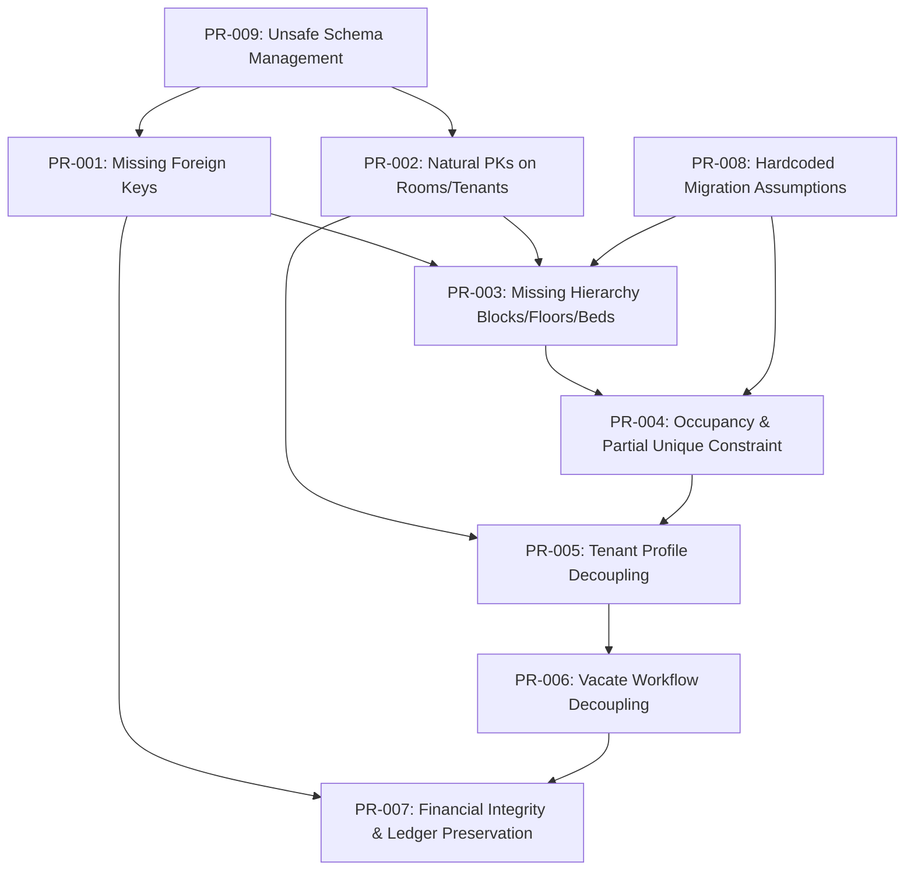

# Database Redesign Problem Register

**Project:** Residential Tenant Management and Rent Ledger (RMS)  
**Document Status:** Approved Technical Baseline  
**Audit Scope:** PostgreSQL 17 (`rms_db`), Spring Boot Backend (`rms-backend`), Existing Redesign Documentation  
**Audit Date:** October 18, 2026  

---

## Executive Overview

This Problem Register establishes the verified technical deficiencies, data integrity risks, architectural bottlenecks, and migration hazards identified across the RMS persistence layer. Every problem documented below is backed by empirical evidence gathered from:
1. Live database catalog inspection (`pg_constraint`, `information_schema`, table row inspections on `rms_db`).
2. Source code audit of JPA entities, repositories, DTOs, and services in `com.rms.backend.*`.
3. Discrepancy analysis between historical audit documents (`current-schema-inventory.md`, `data-integrity-report.md`, `target-architecture.md`) and actual runtime behavior.

---

## Problem Index

| Problem ID | Category | Title | Severity | Implementation Phase |
| :--- | :--- | :--- | :--- | :--- |
| **PR-001** | Referential Integrity | Incomplete Database-Enforced Foreign Keys | Critical | Phase 1 (Expand) |
| **PR-002** | Primary Key Design | Natural String Primary Keys on Rooms (`room_no`) and Tenants (`uid`) | High | Phase 3 & 4 (Expand/Migrate) |
| **PR-003** | Hierarchy Modeling | Missing Structural Hierarchy (`Property → Block → Floor → Room → Bed`) | High | Phase 2 & 3 (Expand/Migrate) |
| **PR-004** | Concurrency & Integrity | Occupancy Desynchronization and Flawed `UNIQUE (bed_id, status)` Constraint | Critical | Phase 3 & 5 (Expand/Validate) |
| **PR-005** | Domain Normalization | Coupling of Permanent Tenant Identity with Transient Stay Attributes | High | Phase 4 & 5 (Expand/Migrate) |
| **PR-006** | Lifecycle Integrity | Vacate Workflow Decoupled from Admissions and Incomplete Settlement | High | Phase 6 (Expand/Migrate) |
| **PR-007** | Financial Preservation | Mixed Precision, Orphaned Ledger References, and Cascading Delete Hazards | Critical | Phase 1, 7 & 9 (Protect/Validate) |
| **PR-008** | Migration Validity | Hardcoded Data Assumptions and Unverified Bed/Block Assignments | Medium | Phase 0 & Pre-Migration Gates |
| **PR-009** | Schema Management | Unsafe Hibernate Auto-DDL (`ddl-auto=update`) and Startup SQL Execution | Critical | Phase 0 & 1 (Infrastructure) |

---

## Detailed Problem Specifications

### Problem 1: Incomplete Database-Enforced Referential Integrity (PR-001)

- **Problem ID:** PR-001
- **Current Behavior:** 
  The database relies primarily on application-layer logic to maintain referential integrity. Out of 10 active tables in `rms_db`, only two physical foreign keys exist in PostgreSQL:
  1. `admissions.room_no` &rarr; `rooms.room_no` (`fk6j2g2tty4ukvdgsqwe2ymjmtq`)
  2. `admissions.tenant_uid` &rarr; `tenants.uid` (`fkie3wy2hxh07dq0a28nb0u3g62`)
  All other parent-child relationships (`properties` &rarr; `rooms`, `tenants`, `admissions`, `invoices`, `ledger_transactions`, `vacate_requests`, `payments`; `invoices` &rarr; `payments`; `invoices`/`payments` &rarr; `ledger_transactions`; `tenants` &rarr; `rooms`) are raw scalar columns (`BIGINT` or `VARCHAR`) with zero physical database constraints.
- **Evidence & Affected Tables/Code:**
  - Database Query: `information_schema.referential_constraints` returns exactly 2 rows.
  - Script Discrepancy: `src/main/resources/migration_property_identifier.sql` attempted to create `fk_*_property` foreign keys with `ON DELETE SET NULL`, but these were never applied to the active database.
  - Entities: `Room.java` (line 42: `@Column(name = "property_id") private Long propertyId;` - no `@ManyToOne`), `Tenant.java` (line 54: `@Column(name = "property_id") private Long propertyId;`), `Invoice.java` (line 36), `Payment.java` (line 52), `LedgerTransaction.java` (line 50), `VacateRequest.java` (line 41).
- **Root Cause:** Initial rapid prototyping relied on Spring Boot and Hibernate JPA without generating physical DDL foreign keys, compounded by loose `Long propertyId` scalar mapping.
- **Business & Financial Impact:** High risk of orphaned financial records, dangling billing entries, and ghost tenants. An administrative deletion of a property or room can leave dangling invoices or admissions, leading to accounting balance corruption.
- **Proposed Solution:** Introduce physical foreign key constraints using an **Expand-Migrate-Validate-Contract (EMVC)** sequence. Enforce `ON DELETE RESTRICT` on all parent entities containing financial or audit history to prevent catastrophic cascade deletions.
- **Required Schema Changes:**
  ```sql
  ALTER TABLE rooms ADD CONSTRAINT fk_rooms_property FOREIGN KEY (property_id) REFERENCES properties(id) ON DELETE RESTRICT;
  ALTER TABLE tenants ADD CONSTRAINT fk_tenants_property FOREIGN KEY (property_id) REFERENCES properties(id) ON DELETE RESTRICT;
  ALTER TABLE admissions ADD CONSTRAINT fk_admissions_property FOREIGN KEY (property_id) REFERENCES properties(id) ON DELETE RESTRICT;
  ALTER TABLE invoices ADD CONSTRAINT fk_invoices_property FOREIGN KEY (property_id) REFERENCES properties(id) ON DELETE RESTRICT;
  ALTER TABLE payments ADD CONSTRAINT fk_payments_property FOREIGN KEY (property_id) REFERENCES properties(id) ON DELETE RESTRICT;
  ALTER TABLE payments ADD CONSTRAINT fk_payments_invoice FOREIGN KEY (invoice_id) REFERENCES invoices(id) ON DELETE RESTRICT;
  ALTER TABLE ledger_transactions ADD CONSTRAINT fk_ledger_property FOREIGN KEY (property_id) REFERENCES properties(id) ON DELETE RESTRICT;
  ALTER TABLE vacate_requests ADD CONSTRAINT fk_vacate_property FOREIGN KEY (property_id) REFERENCES properties(id) ON DELETE RESTRICT;
  ```
- **Required Backend Changes:** Update JPA entity mappings to reflect `@ManyToOne(fetch = FetchType.LAZY)` with `@JoinColumn`, while retaining backward-compatible scalar getters/setters during Phase 1.
- **Data Migration Requirements:** Run pre-validation scripts to confirm 0 orphaned rows before adding constraints. (Current audit verified 0 orphans in test database).
- **Validation & Rollback Criteria:** Constraint addition is reversible via `ALTER TABLE ... DROP CONSTRAINT`. Validation passes when queries for `NOT IN (SELECT id FROM properties)` return 0 rows.
- **Dependencies & Implementation Phase:** Phase 1 (Foundation & Property Safeguards).
- **Acceptance Criteria:** Every table referencing `properties`, `rooms`, `tenants`, or `invoices` has an active, catalog-verified `FOREIGN KEY` constraint with `ON DELETE RESTRICT`.

---

### Problem 2: Natural Primary Keys for Rooms and Tenants (PR-002)

- **Problem ID:** PR-002
- **Current Behavior:** 
  - `rooms` uses `room_no` (`VARCHAR(255)`) as its primary key.
  - `tenants` uses `uid` (`VARCHAR(255)`) as its primary key.
- **Evidence & Affected Tables/Code:**
  - Schema: `\d rooms` shows `rooms_pkey PRIMARY KEY, btree (room_no)`.
  - Schema: `\d tenants` shows `tenants_pkey PRIMARY KEY, btree (uid)`.
  - Java: `Room.java` line 23 (`@Id private String roomNo;`), `Tenant.java` line 18 (`@Id @Column(name = "uid") private String uid;`).
- **Root Cause:** Domain natural keys were assigned as physical primary keys during initial design.
- **Business & Financial Impact:**
  - Room Number Collisions: Prevents multi-property operations. Property A and Property B cannot both contain "Room 101" because `room_no` is globally unique across the database.
  - String Foreign Key Inefficiency: Foreign keys referencing string keys (`admissions.room_no`, `admissions.tenant_uid`, `invoices.tenant_uid`) consume excessive index space and complicate room renumbering or tenant identity updates.
- **Proposed Solution:**
  1. Add surrogate `id BIGINT GENERATED ALWAYS AS IDENTITY PRIMARY KEY` to `rooms` and `tenants`.
  2. Scope room uniqueness to property/floor: `UNIQUE (property_id, room_number)`.
  3. Retain `tenants.uid` as a stable, globally unique alternate key (`VARCHAR(100) UNIQUE NOT NULL`) for external API contracts.
  4. Perform multi-phase migration: add surrogate columns &rarr; backfill &rarr; update dependent foreign keys &rarr; adjust PK constraints.
- **Required Schema Changes:**
  ```sql
  -- Step 1 (Expand): Add surrogate columns
  ALTER TABLE rooms ADD COLUMN id BIGINT GENERATED ALWAYS AS IDENTITY;
  ALTER TABLE tenants ADD COLUMN id BIGINT GENERATED ALWAYS AS IDENTITY;
  -- Step 2: Backfill relationships and swap PKs after foreign keys point to id
  -- Step 3: Add scoped uniqueness
  ALTER TABLE rooms ADD CONSTRAINT uk_rooms_property_number UNIQUE (property_id, room_no);
  ALTER TABLE tenants ADD CONSTRAINT uk_tenants_uid UNIQUE (uid);
  ```
- **Required Backend Changes:**
  - Update `Room` and `Tenant` entities to use `Long id` as `@Id`.
  - Retain `getRoomNo()` and `getUid()` across DTOs and API endpoints for non-breaking contract compatibility.
  - Update repositories (`findByPropertyIdAndRoomNumber`, `findByUid`).
- **Data Migration Requirements:**
  - Populate `room_id` in `admissions`, `vacate_requests` by joining on `rooms.room_no`.
  - Populate `tenant_id` in `admissions`, `invoices`, `payments`, `ledger_transactions`, `vacate_requests` by joining on `tenants.uid`.
- **Validation & Rollback Criteria:** All existing admissions, invoices, and payments must resolve to identical tenant/room entities before dropping legacy string foreign keys.
- **Dependencies & Implementation Phase:** Phase 3 (Rooms) and Phase 4 (Tenants).
- **Acceptance Criteria:** `rooms.id` and `tenants.id` are surrogate `BIGINT` PKs. Room numbers can be duplicated across distinct properties without constraint violation.

---

### Problem 3: Missing Structural Hierarchy (`Property → Block → Floor → Room → Bed`) (PR-003)

- **Problem ID:** PR-003
- **Current Behavior:**
  - No `blocks` table exists.
  - No `floors` table exists (`rooms.floor` is a flat free-text `VARCHAR(255)` storing values like `'1'`, `'2'`).
  - No `beds` table exists (individual beds cannot be identified, allocated, priced, or serviced).
- **Evidence & Affected Tables/Code:**
  - Database Catalog: Tables `blocks`, `floors`, `beds` do not exist.
  - `Room.java` line 25: `private String floor;` line 31: `private Integer occupancy;` (aggregate capacity only).
  - Live Data: `rooms` contains 6 rooms on floor `'1'` and `'2'`.
- **Root Cause:** Simplified initial model treated buildings as flat collections of numbered rooms.
- **Business & Financial Impact:**
  - Inability to assign specific beds to residents.
  - Inability to charge differentiated rent for different beds within the same room (e.g. window bed vs standard bed).
  - Inability to model multi-block properties (e.g. Block A Boys, Block B Girls).
  - Free-text `floor` column risks dirty data (e.g. `'1'`, `'1st Floor'`, `'First Floor'`, `'Floor 1'`).
- **Proposed Solution:**
  1. Introduce `blocks` (`id`, `property_id`, `name`, `code`, `status`).
  2. Introduce `floors` (`id`, `block_id`, `floor_number`, `name`, `status`).
  3. Introduce `beds` (`id`, `room_id`, `bed_number`, `base_rent`, `status`).
  4. Redundant Relationship Resolution: `rooms` will reference `floor_id` as its direct hierarchical parent. Because `floor` belongs to `block` and `block` belongs to `property`, `rooms.property_id` is structurally redundant. To maintain high-performance property filtering and avoid multi-table joins in high-volume queries, `rooms.property_id` is retained as a denormalized foreign key, enforced via application service transactions and database validation triggers.
  5. Backfill default block ("Main Block") and map distinct numeric floor strings to structured floor entities.
- **Required Schema Changes:**
  ```sql
  CREATE TABLE blocks (
      id BIGINT GENERATED ALWAYS AS IDENTITY PRIMARY KEY,
      property_id BIGINT NOT NULL REFERENCES properties(id) ON DELETE RESTRICT,
      name VARCHAR(100) NOT NULL,
      code VARCHAR(50) NOT NULL,
      status VARCHAR(50) NOT NULL DEFAULT 'ACTIVE',
      created_at TIMESTAMPTZ NOT NULL DEFAULT NOW(),
      updated_at TIMESTAMPTZ NOT NULL DEFAULT NOW(),
      CONSTRAINT uk_blocks_property_code UNIQUE (property_id, code)
  );

  CREATE TABLE floors (
      id BIGINT GENERATED ALWAYS AS IDENTITY PRIMARY KEY,
      block_id BIGINT NOT NULL REFERENCES blocks(id) ON DELETE RESTRICT,
      floor_number INT NOT NULL,
      name VARCHAR(100) NOT NULL,
      status VARCHAR(50) NOT NULL DEFAULT 'ACTIVE',
      created_at TIMESTAMPTZ NOT NULL DEFAULT NOW(),
      updated_at TIMESTAMPTZ NOT NULL DEFAULT NOW(),
      CONSTRAINT uk_floors_block_number UNIQUE (block_id, floor_number)
  );

  CREATE TABLE beds (
      id BIGINT GENERATED ALWAYS AS IDENTITY PRIMARY KEY,
      room_id BIGINT NOT NULL REFERENCES rooms(id) ON DELETE CASCADE,
      bed_number VARCHAR(50) NOT NULL,
      base_rent INT,
      status VARCHAR(50) NOT NULL DEFAULT 'AVAILABLE',
      created_at TIMESTAMPTZ NOT NULL DEFAULT NOW(),
      updated_at TIMESTAMPTZ NOT NULL DEFAULT NOW(),
      CONSTRAINT uk_beds_room_number UNIQUE (room_id, bed_number)
  );
  ```
- **Required Backend Changes:**
  - Create entities `Block`, `Floor`, `Bed`.
  - Update `Room` to hold `@ManyToOne Floor floor`.
  - Add hierarchy traversal services and DTOs.
- **Data Migration Requirements:**
  - For each existing property, insert a default block: `INSERT INTO blocks (property_id, name, code) SELECT id, 'Main Block', 'BLK-' || code FROM properties;`
  - For each distinct `rooms.floor`, insert into `floors` with parsed integer `floor_number`.
  - For each room with capacity $N$, auto-generate $N$ beds (`Bed 1` to `Bed N`).
- **Validation & Rollback Criteria:**
  - Every room must reference a valid `floor_id`.
  - Every floor must reference a valid `block_id`.
  - Total bed count across a room's beds must equal `rooms.occupancy`.
- **Dependencies & Implementation Phase:** Phase 2 (Blocks/Floors) and Phase 3 (Beds).
- **Acceptance Criteria:** Full 5-tier relational navigation is operational in DB and API. No room has an invalid or orphaned floor/block.

---

### Problem 4: Admission and Occupancy Consistency & Broken Partial Unique Constraint (PR-004)

- **Problem ID:** PR-004
- **Current Behavior:**
  - Room occupancy is tracked through three mutable integer counter columns on `rooms`: `current_occupancy`, `reserved_capacity`, and boolean `available`.
  - Active stays and room allocations are checked via application code rather than guaranteed by relational constraints.
  - Previous redesign proposal suggested: `CONSTRAINT uk_admissions_bed_status UNIQUE (bed_id, status)`.
- **Evidence & Affected Tables/Code:**
  - `Room.java` lines 33-40: `currentOccupancy`, `reservedCapacity`.
  - `AdmissionService.java` lines 92-95: manual increments of `reservedCapacity`.
  - Flawed Proposal in `migration-plan.md` line 65: `Enforce UNIQUE (bed_id, status) where status in ('PENDING', 'PAID')`.
  - State Machine in `AdmissionStatus.java`: `PENDING`, `PAID`, `CANCELLED`, `VACATED`.
- **Root Cause:**
  1. A standard unique constraint `UNIQUE (bed_id, status)` is mathematically and logically defective:
     - It allows ONE `PENDING` admission AND ONE `PAID` admission on the EXACT SAME BED simultaneously, failing to prevent double-booking!
     - It blocks historical admissions: once Bed 1 has an admission with status `VACATED`, no subsequent resident vacating Bed 1 could ever have status `VACATED`!
- **Business & Financial Impact:** Double-selling beds to multiple residents during concurrent bookings. Counter drift where `current_occupancy` fails to match actual active residents due to partial transaction failures or manual database edits.
- **Proposed Solution:**
  1. Eliminate the flawed `UNIQUE (bed_id, status)` constraint.
  2. Implement a PostgreSQL **Partial Unique Index** targeting active/reserved occupancy states only:
     ```sql
     CREATE UNIQUE INDEX uk_admissions_active_bed_exclusive
     ON admissions (bed_id)
     WHERE status IN ('PENDING', 'PAID') AND bed_id IS NOT NULL;
     ```
  3. Derive room occupancy dynamically:
     - Room Occupied Beds: `COUNT(*) FROM beds WHERE room_id = :roomId AND status = 'OCCUPIED'`.
     - Room Reserved Beds: `COUNT(*) FROM admissions WHERE room_id = :roomId AND status = 'PENDING'`.
  4. Use explicit database row-level locking (`SELECT ... FOR UPDATE` via `@Lock(LockModeType.PESSIMISTIC_WRITE)`) on `beds` during enrollment and confirmation.
- **Required Schema Changes:**
  - Add `bed_id BIGINT REFERENCES beds(id)` to `admissions`.
  - Create the partial unique index `uk_admissions_active_bed_exclusive`.
- **Required Backend Changes:**
  - Update `AdmissionService.createEnrollment` to select and lock an `AVAILABLE` bed.
  - Transition bed status: `AVAILABLE` &rarr; `RESERVED` (on enrollment) &rarr; `OCCUPIED` (on confirmation) &rarr; `AVAILABLE` (on vacate).
- **Data Migration Requirements:**
  - Assign existing active admissions (`ADM-1001` Vinayak R, `ADM-0002` Biju K, `ADM-0003` Rasul) to distinct generated beds in their respective rooms.
- **Validation & Rollback Criteria:**
  - Automated test verifying that concurrent enrollment attempts for the same bed result in a constraint violation error for the second transaction.
- **Dependencies & Implementation Phase:** Phase 3 (Beds) and Phase 5 (Transactional Admissions).
- **Acceptance Criteria:** Exactly one resident can occupy or reserve a bed at any given instant. Unlimited historical (`VACATED`, `CANCELLED`) records can exist for that bed.

---

### Problem 5: Tenant Profile and Admission Separation (PR-005)

- **Problem ID:** PR-005
- **Current Behavior:**
  - `tenants` stores transient accommodation attributes directly on the resident row: `room_no`, `standard_rent`, `advance_paid`, `advance_paid_status`, `property_id`, `status`.
  - When an inactive tenant returns for a new stay, `AdmissionService.resolveOrCreateTenant()` directly **overwrites** `room_no`, `standard_rent`, and `advance_paid` on the tenant table.
- **Evidence & Affected Tables/Code:**
  - Schema: `tenants` table contains columns `room_no`, `advance_paid`, `standard_rent`, `status`.
  - `Tenant.java` lines 39-51.
  - `AdmissionService.java` lines 322-343:
    ```java
    tenant.setRoomNo(dto.getRoomNo());
    tenant.setStandardRent(dto.getStandardRent());
    tenant.setAdvancePaid(dto.getAdvancePaid());
    tenant.setAdvancePaidStatus(AdvancePaidStatus.PENDING);
    ```
- **Root Cause:** Lack of separation between the resident entity (person/KYC) and the stay agreement/admission lifecycle.
- **Business & Financial Impact:** Destroys historical stay records on the tenant entity. If a tenant lived in Room 100 at ₹8,500 in 2024, vacated, and returned to Room 202 at ₹9,000 in 2026, their historical room and rent records on `tenants` are overwritten, breaking historical tenant-level reporting.
- **Proposed Solution:**
  1. Redefine `tenants` as a pure resident/identity profile: name, contact, Aadhaar/passport, emergency contacts, KYC documents.
  2. Maintain all stay-specific parameters (`room_id`, `bed_id`, `property_id`, `enrollment_date`, `vacated_on`, `status`, `agreed_rent`, `deposit_paid`) inside `admissions` (and future `rent_agreements`).
  3. Retain legacy columns on `tenants` during Phase 4 as deprecated read/write compatibility fields, updating them via application service hooks until API contraction.
- **Required Schema Changes:**
  - Add `agreed_rent INT` and `deposit_paid INT` to `admissions`.
  - Ensure `tenants.room_no`, `tenants.standard_rent`, `tenants.advance_paid` become nullable in Phase 4.
- **Required Backend Changes:**
  - Refactor `resolveOrCreateTenant` to never overwrite past financial agreements; create a fresh `Admission` row instead.
  - Expose current stay info in `TenantResponseDto` by querying the resident's active admission (`status = 'PAID'`).
- **Data Migration Requirements:**
  - Copy historical `advance_paid` and `standard_rent` from `tenants` into the corresponding active admission records.
- **Validation & Rollback Criteria:**
  - Verify that past vacated admissions retain their historical rent and room assignments when a tenant re-enrolls.
- **Dependencies & Implementation Phase:** Phase 4 (Tenant Profile Decoupling) and Phase 5 (Admissions).
- **Acceptance Criteria:** A resident can have multiple historical admissions across different rooms/properties over time without mutating their permanent `tenants` identity record.

---

### Problem 6: Vacate Workflow and Financial Settlement Decoupling (PR-006)

- **Problem ID:** PR-006
- **Current Behavior:**
  - `vacate_requests` has NO foreign key to `admissions`. It stores loose string fields: `tenant_uid`, `tenant_name`, `room_no`, `mobile_number`, `aadhaar_no`, and loose `property_id`.
  - When a vacate request is completed (`completeVacate()` in `VacateRequestService.java`):
    1. It sets `vacate_requests.status = COMPLETED`.
    2. It sets `tenants.status = INACTIVE`.
    3. It clears room vacate columns and decrements room occupancy.
    4. **It NEVER updates the `admissions` record!** The admission remains in `PAID` status indefinitely!
    5. It never records any ledger transaction, refund voucher, or deposit settlement entry!
  - Discrepancy in documentation: `current-schema-inventory.md` documented vacate statuses as `SUBMITTED, APPROVED, REJECTED, COMPLETED`, whereas `VacateStatus.java` actually defines: `PENDING, APPROVED, REJECTED, COMPLETED, CANCELLED`.
- **Evidence & Affected Tables/Code:**
  - `VacateRequest.java` line 25: `private String tenantUid;` line 31: `private String roomNo;` (no `admissionId`).
  - `VacateRequestService.java` lines 266-298 (`completeVacate` method): contains 0 calls to `admissionRepository`.
  - `AdmissionService.java` line 314: marks admissions `VACATED` *only* if the tenant subsequently returns and re-enrolls.
- **Root Cause:** Vacate processing was built as an independent notification module rather than the formal closure phase of an admission lifecycle.
- **Business & Financial Impact:**
  - Severe data inconsistency: a tenant is marked `INACTIVE`, but their admission remains active (`PAID`), resulting in incorrect active resident counts and audit discrepancies.
  - Zero financial accounting: deposits repayable are calculated on paper (`advance_repayable`), but never posted to the double-entry ledger upon checkout.
- **Proposed Solution:**
  1. Add mandatory `admission_id BIGINT REFERENCES admissions(id) ON DELETE RESTRICT` to `vacate_requests`.
  2. Make `completeVacate()` an atomic transactional workflow:
     - Update `vacate_requests.status = COMPLETED`.
     - Update `admissions.status = VACATED` and `admissions.vacated_on = actual_vacate_date`.
     - Update `beds.status = AVAILABLE`.
     - Update `tenants.status = INACTIVE` (if no other active admissions exist).
     - Post settlement ledger transactions for maintenance/breakage deductions and net deposit refunds.
  3. Clarify `ON DELETE` rules: all references from `vacate_requests` must use `ON DELETE RESTRICT` (or `ON DELETE SET NULL` for bed if bed is reconfigured) to prevent accidental loss of checkout audit trails.
- **Required Schema Changes:**
  ```sql
  ALTER TABLE vacate_requests ADD COLUMN admission_id BIGINT;
  ALTER TABLE vacate_requests ADD CONSTRAINT fk_vacate_admission 
      FOREIGN KEY (admission_id) REFERENCES admissions(id) ON DELETE RESTRICT;
  ```
- **Required Backend Changes:**
  - Update `VacateRequestDto` and `VacateRequestService` to link `admission_id`.
  - In `completeVacate`, close the corresponding admission and emit financial settlement records.
- **Data Migration Requirements:**
  - Backfill `admission_id` for any existing vacate records by matching `tenant_uid`, `room_no`, and stay dates. (Current database has 0 vacate records).
- **Validation & Rollback Criteria:**
  - Automated test verifying that completing a vacate request sets `admission.status = 'VACATED'` and frees the occupied bed.
- **Dependencies & Implementation Phase:** Phase 6 (Vacate & Historical Occupancy).
- **Acceptance Criteria:** Every vacate request links to a distinct admission. Completing a vacate request atomically marks the admission vacated and frees the bed.

---

### Problem 7: Financial Integrity, Mixed Monetary Types, and Ledger Preservation (PR-007)

- **Problem ID:** PR-007
- **Current Behavior:**
  - Mixed Data Types for Money:
    - `invoices.amount`, `invoices.paid_amount`: `INTEGER`.
    - `payments.amount`: `INTEGER`.
    - `ledger_transactions.amount`: `INTEGER`.
    - `vacate_requests.advance_paid`, `vacate_requests.advance_repayable`, `maintenance_charge`, `breakage_charge`: `DOUBLE PRECISION`.
    - `property_archive_snapshots.total_revenue_potential`, `total_advance_held`: `DOUBLE PRECISION`.
  - Incomplete Historical References in Active Database:
    - In `ledger_transactions`, existing rows have `invoice_id = NULL`, `payment_id = NULL`, and `tenant_uid = ''` (empty string).
    - `reference_number` currently holds the invoice transaction reference string (`TXN-1790344206862`).
    - The `payments` table has 0 rows because payments in the legacy flow directly mutated `invoices` and appended to `ledger_transactions`.
- **Evidence & Affected Tables/Code:**
  - Database Query on `ledger_transactions`: 3 records present; `invoice_id` is `NULL`, `payment_id` is `NULL`, `running_balance` values are 8500, 17000, 19500.
  - Schema types: `\d vacate_requests` shows `double precision` for monetary columns.
  - `BillingService.java` lines 259-275: creates `LedgerTransaction` linked to `invoice.getId()`, but legacy rows lack these linkages.
- **Root Cause:** Evolution from an ad-hoc billing ledger to an authoritative payment model without backfilling legacy transaction references, combined with inconsistent Java primitive typing (`Integer` vs `Double`).
- **Business & Financial Impact:**
  - High financial risk: `DOUBLE PRECISION` causes IEEE 754 floating-point rounding errors (e.g. `15000.00 - 1200.50 = 13799.499999999998`).
  - Imposing strict `NOT NULL` foreign keys on `ledger_transactions.invoice_id` or `payment_id` would corrupt or invalidate existing accounting records.
  - Cascading deletes on properties or tenants would destroy historical tax and audit records.
- **Proposed Solution:**
  1. Standardize all monetary columns on exact numerical representation:
     - Transition monetary columns across all tables to `NUMERIC(12, 2)` (or standard integer paise) with explicit rounding rules (`RoundingMode.HALF_UP`).
  2. Financial Ledger Preservation Rule:
     - Existing primary keys, reference numbers, amounts, transaction types (`CREDIT`/`DEBIT`), and running balances must be treated as **immutable**.
     - Foreign keys on `ledger_transactions` (`tenant_id`, `invoice_id`, `payment_id`) MUST remain nullable to accommodate legacy and direct ledger entries.
     - Never regenerate invoices, synthesize fabricated payment records, or alter historical running balances during schema migration.
  3. Apply `ON DELETE RESTRICT` to all financial relations. Never allow `ON DELETE CASCADE`.
- **Required Schema Changes:**
  ```sql
  -- Future monetary harmonization:
  ALTER TABLE vacate_requests ALTER COLUMN advance_paid TYPE NUMERIC(12, 2);
  ALTER TABLE vacate_requests ALTER COLUMN advance_repayable TYPE NUMERIC(12, 2);
  ALTER TABLE vacate_requests ALTER COLUMN maintenance_charge TYPE NUMERIC(12, 2);
  ALTER TABLE vacate_requests ALTER COLUMN breakage_charge TYPE NUMERIC(12, 2);
  ```
- **Required Backend Changes:**
  - Standardize Java DTOs and entities on `BigDecimal` (or consistent `Integer` for whole rupee models).
  - Ensure `BillingService` reconciles `running_balance` without modifying historical ledger rows.
- **Data Migration Requirements:**
  - Reconcile the 3 existing legacy ledger rows against invoices using `reference_number = transaction_ref` where deterministic linkage is possible, without mutating immutable amount/balance fields.
- **Validation & Rollback Criteria:**
  - Pre-migration sum of ledger credits/debits must exactly match post-migration sum:
    `SELECT SUM(amount) FROM ledger_transactions` must remain exactly ₹19,500.
- **Dependencies & Implementation Phase:** Phase 1 (Restraints), Phase 7 (Precision Harmonization), Phase 9 (Financial Audit).
- **Acceptance Criteria:** Financial history is 100% preserved. Monetary fields have exact precision. No historical records are deleted or modified.

---

### Problem 8: Unverified Existing Data & Migration Assumptions (PR-008)

- **Problem ID:** PR-008
- **Current Behavior:**
  - Previous redesign documents made hardcoded assumptions based on sample data:
    - Hardcoded default block name `"Main Block"` and code `"BLK-A"`.
    - Hardcoding bed assignments for tenants (e.g. assigning Biju K to Bed 100-1 and Rasul to Bed 100-2).
    - Assuming all properties follow identical floor numbering conventions.
- **Evidence & Affected Tables/Code:**
  - `migration-plan.md` lines 38, 49-50: explicitly names Biju K and Rasul for Bed 100-1 and 100-2 without database-backed bed mapping logic.
  - Active Database State:
    - Property ID: 5 (`Seyon Stays Womens PG`).
    - Rooms: 100, 101, 102 (Floor 1); 200, 201, 202 (Floor 2).
    - Tenants: Vinayak R (Room 101), Biju K (Room 100), Rasul (Room 100).
- **Root Cause:** Extrapolating a universal migration strategy from a single prototype property dataset without building generic, deterministic mapping pipelines.
- **Business & Financial Impact:** In a production database with multiple properties, hardcoded blocks or naive bed assignments will cause primary key collisions, incorrect tenant bed allocations, and migration script failures.
- **Proposed Solution:**
  1. Build deterministic, parameterized migration scripts:
     - Generate blocks dynamically per property (`BLK-` || `properties.code`).
     - Map distinct `rooms.floor` strings deterministically to floors per block.
     - Generate bed slots dynamically: for a room with capacity $C$, generate beds numbered `1` through $C$.
     - Allocate existing active tenants to bed slots based on deterministic criteria (e.g. ordered by `admission.enrollment_date`, `admission.id`), recording every assignment in an audit table.
  2. Exception Handling: Flag any room whose current occupancy exceeds its capacity, or where tenant records conflict, into an exception review table rather than guessing.
- **Required Schema Changes:** Create a temporary pre-migration validation and exception table `migration_exceptions` to log any ambiguous legacy records.
- **Required Backend Changes:** None for runtime; scripts will be executed through migration tools.
- **Data Migration Requirements:** Verified SQL mappings operating strictly over relational sets without hardcoded IDs.
- **Validation & Rollback Criteria:** Reversible via migration staging scripts. Zero unmapped tenants or rooms.
- **Dependencies & Implementation Phase:** Phase 0 (Baseline Validation) and Phase 2 & 3.
- **Acceptance Criteria:** Migration scripts execute successfully against any property dataset without hardcoded entity names or IDs.

---

### Problem 9: Unsafe Schema Management via Hibernate Auto-DDL (`ddl-auto=update`) (PR-009)

- **Problem ID:** PR-009
- **Current Behavior:**
  - `application.properties` specifies: `spring.jpa.hibernate.ddl-auto=update`.
  - `DataInitializer.java` executes unversioned, imperatively coded SQL `ALTER TABLE` and `UPDATE` statements on every application boot.
- **Evidence & Affected Tables/Code:**
  - `rms-backend/src/main/resources/application.properties` line 15: `spring.jpa.hibernate.ddl-auto=update`.
  - `DataInitializer.java` lines 35-68: executes `jdbcTemplate.execute("ALTER TABLE properties ADD COLUMN IF NOT EXISTS...")`, drops and recreates check constraints, and mutates tenant statuses on startup.
- **Root Cause:** Convenience setup for local rapid prototyping left active in backend configuration.
- **Business & Financial Impact:**
  - High Production Hazard: Hibernate `update` does not drop unused columns, does not reliably apply complex constraints, fails on table renames, and can lock tables or alter types unexpectedly during server restarts.
  - Startup SQL statements in `DataInitializer` bypass version control, cannot be rolled back deterministically, and introduce race conditions in multi-instance deployments.
- **Proposed Solution:**
  1. Transition `application.properties` to `spring.jpa.hibernate.ddl-auto=validate` for all staging and production environments.
  2. Adopt an enterprise migration tool (Flyway or Liquibase) utilizing ordered, version-controlled SQL migration scripts (`V1__...`, `V2__...`).
  3. Remove all DDL and data-mutation logic from `DataInitializer.java`.
  4. Follow the **Expand-Migrate-Validate-Contract** release cadence.
- **Required Schema Changes:** Introduce migration version history table (`flyway_schema_history`).
- **Required Backend Changes:**
  - Add Flyway dependency to `pom.xml`.
  - Set `spring.jpa.hibernate.ddl-auto=validate`.
  - Clean `DataInitializer.java` to act strictly as an optional non-DDL runner.
- **Data Migration Requirements:** Baseline existing active database as `V0__baseline.sql`.
- **Validation & Rollback Criteria:** Application starts cleanly with `ddl-auto=validate` without attempting any automatic schema alteration.
- **Dependencies & Implementation Phase:** Phase 0 (Pre-condition for all structural migrations).
- **Acceptance Criteria:** Zero DDL execution from Hibernate or Java startup code. 100% of schema changes managed by version-controlled migration scripts.

---

## Problem Interdependency Matrix



This register provides the definitive baseline against which all architecture documents, decision logs, migration plans, and validation procedures are aligned.
