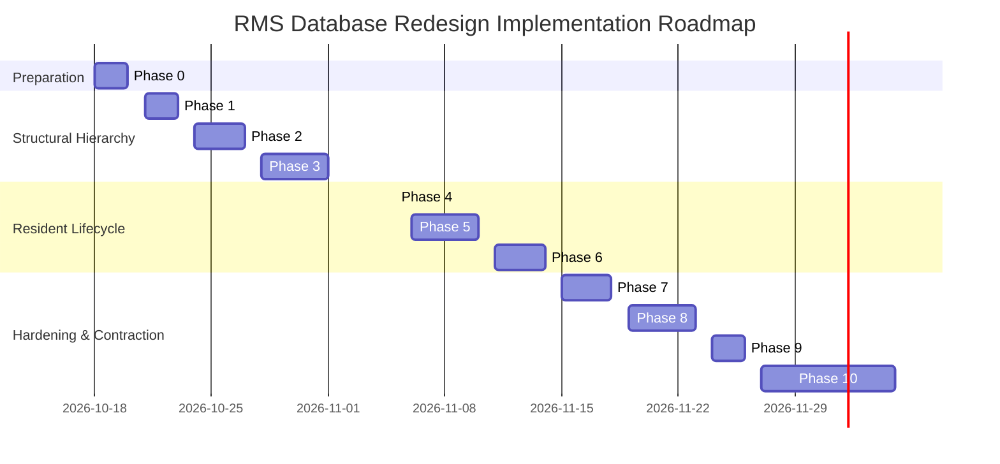

# Safe Incremental Migration Plan (Expand-Migrate-Validate-Contract)

**Project:** Residential Tenant Management and Rent Ledger (RMS)  
**Execution Methodology:** Phased Zero-Downtime Expand-Migrate-Validate-Contract (EMVC)  
**Tooling:** Flyway Versioned Migrations (`V1` to `V10`), PostgreSQL 17, Spring Boot 3.x  
**Safety Mandate:** Zero table drops, zero data loss, exact financial ledger preservation, backward-compatible APIs.

---

## 1. Migration Methodology & Architectural Guardrails

### Core Principles
1. **No Destructive Operations:** Existing tables, primary keys, and historical accounting rows are never dropped or recreated during active operational phases.
2. **Expand-Migrate-Validate-Contract (EMVC) Pattern:**
   - **Expand:** Add new structural tables, surrogate columns, indexes, and nullable foreign keys alongside existing structures without breaking the running backend.
   - **Migrate:** Backfill data using deterministic, repeatable SQL transformations within atomic transactions.
   - **Validate:** Verify 100% referential coverage, row counts, occupancy consistency, and mathematical balance equivalence before activating new application logic.
   - **Transition:** Switch backend entities and repositories to read/write against new structures while maintaining compatibility wrappers.
   - **Contract:** Deprecate and safely remove legacy columns only after all consumers have transitioned and an audited quarantine window has passed.
3. **Migration Governance:**
   - Eliminate Hibernate `ddl-auto=update` and eliminate startup DDL execution from `DataInitializer.java`.
   - Set `spring.jpa.hibernate.ddl-auto=validate`.
   - Enforce all structural schema changes through ordered, version-controlled Flyway migration scripts.
4. **Recovery Strategy:**
   - Reversible schema additions are rolled back via forward-fix scripts or point-in-time recovery (PITR).
   - Naive `DOWN` scripts that drop columns are strictly prohibited on tables containing financial or resident data.

---

## 2. Phase-by-Phase Implementation Roadmap



---

## 3. Detailed Phase Specifications

### Phase 0: Baseline Freeze & Flyway Infrastructure
- **Objective:** Freeze existing schema, purge uncontrolled startup DDL, and establish Flyway versioning.
- **Preconditions:** Full database dump (`pg_dump -Fc rms_db > rms_db_phase0_baseline.dump`) verified.
- **SQL / Flyway Action:**
  - Create baseline migration `V0__baseline_schema.sql` reflecting current 10 tables.
  - Baseline Flyway table: `flyway baseline -baselineVersion=0`.
- **Backend Action:**
  - Add `flyway-core` and `flyway-database-postgresql` to `pom.xml`.
  - Update `application.properties`:
    ```properties
    spring.jpa.hibernate.ddl-auto=validate
    spring.flyway.enabled=true
    spring.flyway.baseline-on-migrate=true
    ```
  - Remove all `ALTER TABLE` and `UPDATE` statements from `DataInitializer.java`.
- **Validation:** Application boots cleanly with zero schema validation errors.

---

### Phase 1: Property Safeguards & Physical Foreign Keys (PR-001, DEC-006)
- **Objective:** Establish physical database referential integrity from all child entities to `properties(id)` with `ON DELETE RESTRICT`.
- **SQL Script (`V1__property_safeguards.sql`):**
  ```sql
  -- Add indexes to prevent lock contention during foreign key checks
  CREATE INDEX IF NOT EXISTS idx_rooms_property_id ON rooms(property_id);
  CREATE INDEX IF NOT EXISTS idx_tenants_property_id ON tenants(property_id);
  CREATE INDEX IF NOT EXISTS idx_admissions_property_id ON admissions(property_id);
  CREATE INDEX IF NOT EXISTS idx_invoices_property_id ON invoices(property_id);
  CREATE INDEX IF NOT EXISTS idx_payments_property_id ON payments(property_id);
  CREATE INDEX IF NOT EXISTS idx_ledger_property_id ON ledger_transactions(property_id);
  CREATE INDEX IF NOT EXISTS idx_vacate_property_id ON vacate_requests(property_id);

  -- Apply physical foreign keys
  ALTER TABLE rooms ADD CONSTRAINT fk_rooms_property FOREIGN KEY (property_id) REFERENCES properties(id) ON DELETE RESTRICT;
  ALTER TABLE tenants ADD CONSTRAINT fk_tenants_property FOREIGN KEY (property_id) REFERENCES properties(id) ON DELETE RESTRICT;
  ALTER TABLE admissions ADD CONSTRAINT fk_admissions_property FOREIGN KEY (property_id) REFERENCES properties(id) ON DELETE RESTRICT;
  ALTER TABLE invoices ADD CONSTRAINT fk_invoices_property FOREIGN KEY (property_id) REFERENCES properties(id) ON DELETE RESTRICT;
  ALTER TABLE payments ADD CONSTRAINT fk_payments_property FOREIGN KEY (property_id) REFERENCES properties(id) ON DELETE RESTRICT;
  ALTER TABLE payments ADD CONSTRAINT fk_payments_invoice FOREIGN KEY (invoice_id) REFERENCES invoices(id) ON DELETE RESTRICT;
  ALTER TABLE ledger_transactions ADD CONSTRAINT fk_ledger_property FOREIGN KEY (property_id) REFERENCES properties(id) ON DELETE RESTRICT;
  ALTER TABLE vacate_requests ADD CONSTRAINT fk_vacate_property FOREIGN KEY (property_id) REFERENCES properties(id) ON DELETE RESTRICT;
  ```
- **Backend Action:** Update JPA entities with `@ManyToOne(fetch = FetchType.LAZY)`.
- **Validation:** Run Area 2 orphan diagnostic query. Verify 0 orphans.

---

### Phase 2: Blocks and Floors Hierarchy (PR-003, DEC-008)
- **Objective:** Introduce `blocks` and `floors` tables and map existing flat `rooms.floor` strings.
- **SQL Script (`V2__blocks_and_floors_hierarchy.sql`):**
  ```sql
  -- 1. Create blocks table
  CREATE TABLE IF NOT EXISTS blocks (
      id BIGINT GENERATED ALWAYS AS IDENTITY PRIMARY KEY,
      property_id BIGINT NOT NULL REFERENCES properties(id) ON DELETE RESTRICT,
      name VARCHAR(100) NOT NULL,
      code VARCHAR(50) NOT NULL,
      status VARCHAR(50) NOT NULL DEFAULT 'ACTIVE',
      created_at TIMESTAMPTZ NOT NULL DEFAULT NOW(),
      updated_at TIMESTAMPTZ NOT NULL DEFAULT NOW(),
      CONSTRAINT uk_blocks_property_code UNIQUE (property_id, code)
  );

  -- 2. Create floors table
  CREATE TABLE IF NOT EXISTS floors (
      id BIGINT GENERATED ALWAYS AS IDENTITY PRIMARY KEY,
      block_id BIGINT NOT NULL REFERENCES blocks(id) ON DELETE RESTRICT,
      floor_number INT NOT NULL,
      name VARCHAR(100) NOT NULL,
      status VARCHAR(50) NOT NULL DEFAULT 'ACTIVE',
      created_at TIMESTAMPTZ NOT NULL DEFAULT NOW(),
      updated_at TIMESTAMPTZ NOT NULL DEFAULT NOW(),
      CONSTRAINT uk_floors_block_number UNIQUE (block_id, floor_number)
  );

  -- 3. Dynamic backfill: Default block for existing properties
  INSERT INTO blocks (property_id, name, code, status)
  SELECT id, 'Main Block', 'BLK-' || code, 'ACTIVE'
  FROM properties p
  WHERE NOT EXISTS (SELECT 1 FROM blocks b WHERE b.property_id = p.id);

  -- 4. Dynamic backfill: Extract floors from distinct rooms.floor
  INSERT INTO floors (block_id, floor_number, name, status)
  SELECT DISTINCT 
      b.id,
      CAST(r.floor AS INT),
      'Floor ' || r.floor,
      'ACTIVE'
  FROM rooms r
  JOIN blocks b ON b.property_id = r.property_id
  WHERE r.floor ~ '^[0-9]+$'
    AND NOT EXISTS (
        SELECT 1 FROM floors f 
        WHERE f.block_id = b.id AND f.floor_number = CAST(r.floor AS INT)
    );

  -- 5. Expand rooms table with nullable floor_id
  ALTER TABLE rooms ADD COLUMN IF NOT EXISTS floor_id BIGINT;
  
  -- 6. Link rooms.floor_id
  UPDATE rooms r
  SET floor_id = f.id
  FROM floors f
  JOIN blocks b ON f.block_id = b.id
  WHERE r.property_id = b.property_id 
    AND r.floor ~ '^[0-9]+$'
    AND f.floor_number = CAST(r.floor AS INT)
    AND r.floor_id IS NULL;

  -- 7. Add foreign key
  ALTER TABLE rooms ADD CONSTRAINT fk_rooms_floor 
      FOREIGN KEY (floor_id) REFERENCES floors(id) ON DELETE RESTRICT;
  CREATE INDEX IF NOT EXISTS idx_rooms_floor_id ON rooms(floor_id);
  ```
- **Validation:** Area 3 hierarchy consistency query returns 0 discrepancies.

---

### Phase 3: Rooms Surrogate PK and Bed Inventory (PR-002, PR-003, DEC-001)
- **Objective:** Add surrogate `id` to `rooms`, scope room uniqueness per property, and introduce physical `beds`.
- **SQL Script (`V3__rooms_and_bed_occupancy.sql`):**
  ```sql
  -- 1. Expand rooms with surrogate id
  ALTER TABLE rooms ADD COLUMN IF NOT EXISTS id BIGINT GENERATED ALWAYS AS IDENTITY;
  
  -- 2. Add composite uniqueness on room_number per property
  ALTER TABLE rooms ADD CONSTRAINT uk_rooms_property_number UNIQUE (property_id, room_no);

  -- 3. Create beds table
  CREATE TABLE IF NOT EXISTS beds (
      id BIGINT GENERATED ALWAYS AS IDENTITY PRIMARY KEY,
      room_id BIGINT NOT NULL,
      bed_number VARCHAR(50) NOT NULL,
      base_rent INT,
      status VARCHAR(50) NOT NULL DEFAULT 'AVAILABLE',
      created_at TIMESTAMPTZ NOT NULL DEFAULT NOW(),
      updated_at TIMESTAMPTZ NOT NULL DEFAULT NOW(),
      CONSTRAINT fk_beds_room FOREIGN KEY (room_id) REFERENCES rooms(id) ON DELETE CASCADE,
      CONSTRAINT uk_beds_room_number UNIQUE (room_id, bed_number)
  );
  CREATE INDEX IF NOT EXISTS idx_beds_room_id ON beds(room_id);
  CREATE INDEX IF NOT EXISTS idx_beds_status ON beds(status);

  -- 4. Auto-generate bed slots based on room occupancy
  INSERT INTO beds (room_id, bed_number, base_rent, status)
  SELECT 
      r.id,
      'Bed ' || seq.n,
      r.rent_per_month,
      'AVAILABLE'
  FROM rooms r
  CROSS JOIN LATERAL generate_series(1, r.occupancy) AS seq(n)
  WHERE NOT EXISTS (
      SELECT 1 FROM beds b WHERE b.room_id = r.id AND b.bed_number = 'Bed ' || seq.n
  );
  ```
- **Validation:** Area 4 capacity check: physical beds exactly match `rooms.occupancy`.

---

### Phase 4: Tenant Profile Decoupling (PR-002, PR-005, DEC-004)
- **Objective:** Add surrogate `id` to `tenants`, retain `uid` as unique alternate key, make accommodation fields nullable.
- **SQL Script (`V4__tenant_profile_decoupling.sql`):**
  ```sql
  -- 1. Expand tenants with surrogate id
  ALTER TABLE tenants ADD COLUMN IF NOT EXISTS id BIGINT GENERATED ALWAYS AS IDENTITY;

  -- 2. Ensure uid has explicit unique index
  CREATE UNIQUE INDEX IF NOT EXISTS uk_tenants_uid ON tenants(uid);

  -- 3. Relax stay columns on tenants to prepare for decoupling
  ALTER TABLE tenants ALTER COLUMN room_no DROP NOT NULL;
  ALTER TABLE tenants ALTER COLUMN standard_rent DROP NOT NULL;
  ALTER TABLE tenants ALTER COLUMN advance_paid DROP NOT NULL;
  ```
- **Validation:** Area 1 primary-key uniqueness verification.

---

### Phase 5: Transactional Admissions & Partial Unique Bed Constraint (PR-004, DEC-003)
- **Objective:** Add surrogate foreign keys to `admissions`, allocate active beds, and apply PostgreSQL partial unique index.
- **SQL Script (`V5__transactional_admissions.sql`):**
  ```sql
  -- 1. Expand admissions with surrogate foreign keys
  ALTER TABLE admissions ADD COLUMN IF NOT EXISTS tenant_id BIGINT;
  ALTER TABLE admissions ADD COLUMN IF NOT EXISTS room_id BIGINT;
  ALTER TABLE admissions ADD COLUMN IF NOT EXISTS bed_id BIGINT;
  ALTER TABLE admissions ADD COLUMN IF NOT EXISTS agreed_rent INT;
  ALTER TABLE admissions ADD COLUMN IF NOT EXISTS deposit_paid INT;

  -- 2. Backfill tenant_id and room_id
  UPDATE admissions a SET tenant_id = t.id FROM tenants t WHERE a.tenant_uid = t.uid AND a.tenant_id IS NULL;
  UPDATE admissions a SET room_id = r.id FROM rooms r WHERE a.room_no = r.room_no AND a.room_id IS NULL;

  -- 3. Deterministically assign beds to active admissions
  WITH active_admissions AS (
      SELECT 
          a.id AS admission_id,
          a.room_id,
          ROW_NUMBER() OVER (PARTITION BY a.room_id ORDER BY a.enrollment_date, a.id) AS rn
      FROM admissions a
      WHERE a.status IN ('PENDING', 'PAID')
  ),
  room_beds AS (
      SELECT 
          b.id AS bed_id,
          b.room_id,
          ROW_NUMBER() OVER (PARTITION BY b.room_id ORDER BY b.id) AS rn
      FROM beds b
  )
  UPDATE admissions a
  SET bed_id = rb.bed_id
  FROM active_admissions aa
  JOIN room_beds rb ON aa.room_id = rb.room_id AND aa.rn = rb.rn
  WHERE a.id = aa.admission_id AND a.bed_id IS NULL;

  -- 4. Mark allocated beds OCCUPIED
  UPDATE beds b
  SET status = 'OCCUPIED'
  WHERE b.id IN (SELECT bed_id FROM admissions WHERE status = 'PAID' AND bed_id IS NOT NULL);

  -- 5. Enforce foreign keys
  ALTER TABLE admissions ADD CONSTRAINT fk_admissions_tenant FOREIGN KEY (tenant_id) REFERENCES tenants(id) ON DELETE RESTRICT;
  ALTER TABLE admissions ADD CONSTRAINT fk_admissions_room FOREIGN KEY (room_id) REFERENCES rooms(id) ON DELETE RESTRICT;
  ALTER TABLE admissions ADD CONSTRAINT fk_admissions_bed FOREIGN KEY (bed_id) REFERENCES beds(id) ON DELETE RESTRICT;

  -- 6. CRITICAL: PostgreSQL Partial Unique Index for active/reserved bed occupancy (DEC-003)
  CREATE UNIQUE INDEX IF NOT EXISTS uk_admissions_active_bed_exclusive
  ON admissions (bed_id)
  WHERE status IN ('PENDING', 'PAID') AND bed_id IS NOT NULL;
  ```
- **Validation:** Area 5 bed collision check passes. Concurrency unit test passes.

---

### Phase 6: Vacate Workflow & Ledger Settlement Linkage (PR-006, DEC-005)
- **Objective:** Add mandatory `admission_id` to `vacate_requests` and ensure atomic checkout.
- **SQL Script (`V6__vacate_workflow_settlement.sql`):**
  ```sql
  -- 1. Expand vacate_requests with surrogate keys and admission_id
  ALTER TABLE vacate_requests ADD COLUMN IF NOT EXISTS admission_id BIGINT;
  ALTER TABLE vacate_requests ADD COLUMN IF NOT EXISTS tenant_id BIGINT;
  ALTER TABLE vacate_requests ADD COLUMN IF NOT EXISTS room_id BIGINT;
  ALTER TABLE vacate_requests ADD COLUMN IF NOT EXISTS bed_id BIGINT;

  -- 2. Add foreign keys
  ALTER TABLE vacate_requests ADD CONSTRAINT fk_vacate_admission FOREIGN KEY (admission_id) REFERENCES admissions(id) ON DELETE RESTRICT;
  ALTER TABLE vacate_requests ADD CONSTRAINT fk_vacate_tenant FOREIGN KEY (tenant_id) REFERENCES tenants(id) ON DELETE RESTRICT;
  ALTER TABLE vacate_requests ADD CONSTRAINT fk_vacate_room FOREIGN KEY (room_id) REFERENCES rooms(id) ON DELETE RESTRICT;
  ALTER TABLE vacate_requests ADD CONSTRAINT fk_vacate_bed FOREIGN KEY (bed_id) REFERENCES beds(id) ON DELETE SET NULL;
  ```
- **Backend Action:** Refactor `completeVacate()` in `VacateRequestService.java` to set `admission.status = 'VACATED'` and emit refund ledger records atomically.
- **Validation:** Area 7 admission-to-vacate consistency test passes.

---

### Phase 7: Monetary Harmonization & Ledger Nullability Protection (PR-007, DEC-007, DEC-010)
- **Objective:** Standardize money on exact types while protecting historical ledger transactions.
- **SQL Script (`V7__monetary_harmonization_and_ledger.sql`):**
  ```sql
  -- 1. Harmonize vacate_requests monetary precision
  ALTER TABLE vacate_requests ALTER COLUMN advance_paid TYPE NUMERIC(12, 2);
  ALTER TABLE vacate_requests ALTER COLUMN advance_repayable TYPE NUMERIC(12, 2);
  ALTER TABLE vacate_requests ALTER COLUMN maintenance_charge TYPE NUMERIC(12, 2);
  ALTER TABLE vacate_requests ALTER COLUMN breakage_charge TYPE NUMERIC(12, 2);

  -- 2. Expand invoices and payments with surrogate tenant_id
  ALTER TABLE invoices ADD COLUMN IF NOT EXISTS tenant_id BIGINT REFERENCES tenants(id) ON DELETE RESTRICT;
  UPDATE invoices i SET tenant_id = t.id FROM tenants t WHERE i.tenant_uid = t.uid AND i.tenant_id IS NULL;

  ALTER TABLE payments ADD COLUMN IF NOT EXISTS tenant_id BIGINT REFERENCES tenants(id) ON DELETE RESTRICT;
  UPDATE payments p SET tenant_id = t.id FROM tenants t WHERE p.tenant_uid = t.uid AND p.tenant_id IS NULL;

  -- 3. Expand ledger_transactions with nullable foreign keys (DEC-010)
  ALTER TABLE ledger_transactions ADD COLUMN IF NOT EXISTS tenant_id BIGINT REFERENCES tenants(id) ON DELETE RESTRICT;
  ALTER TABLE ledger_transactions ADD CONSTRAINT fk_ledger_invoice FOREIGN KEY (invoice_id) REFERENCES invoices(id) ON DELETE RESTRICT;
  ALTER TABLE ledger_transactions ADD CONSTRAINT fk_ledger_payment FOREIGN KEY (payment_id) REFERENCES payments(id) ON DELETE RESTRICT;

  -- Backfill tenant_id for ledger where tenant_uid is present
  UPDATE ledger_transactions lt SET tenant_id = t.id FROM tenants t WHERE lt.tenant_uid = t.uid AND lt.tenant_id IS NULL;
  ```
- **Validation:** Area 9 Financial balance reconciliation query: $\Delta \text{Credits} = 0$, $\Delta \text{Debits} = 0$, $\Delta \text{Balance} = 0$.

---

### Phase 8: Transition Application Reads and Writes
- **Objective:** Switch backend repository finders and services to use surrogate IDs while maintaining backward-compatible endpoints.
- **Backend Action:**
  - Update Spring Data repositories to use `Long id`.
  - Update DTO mappers to populate both legacy string identifiers and surrogate IDs.
  - Run full regression test suite (`mvn clean test`).
- **Validation:** Area 11 API compatibility tests pass 100%.

---

### Phase 9: Financial Audit & Staging Reconciliation Gate
- **Objective:** Execute full staging environment dry-run against production backup snapshot.
- **Validation:** All 15 validation areas in `database-redesign-validation-plan.md` return PASS status. Sign-off obtained from Financial Stakeholders.

---

### Phase 10: Contract Phase (Safe Clean-up)
- **Objective:** Drop deprecated transient counter columns and legacy string constraints after verified quarantine period.
- **SQL Script (`V10__contract_legacy_columns.sql`):**
  ```sql
  -- Remove legacy natural foreign key constraints once verified
  ALTER TABLE admissions DROP CONSTRAINT IF EXISTS fk6j2g2tty4ukvdgsqwe2ymjmtq; -- old fk to rooms(room_no)
  ALTER TABLE admissions DROP CONSTRAINT IF EXISTS fkie3wy2hxh07dq0a28nb0u3g62; -- old fk to tenants(uid)

  -- Deprecate denormalized room columns
  ALTER TABLE rooms DROP COLUMN IF EXISTS vacate_date;
  ALTER TABLE rooms DROP COLUMN IF EXISTS vacate_status;
  ALTER TABLE rooms DROP COLUMN IF EXISTS vacating_resident;
  ```
- **Validation:** Application operates with 100% clean schema and zero deprecated column references.
