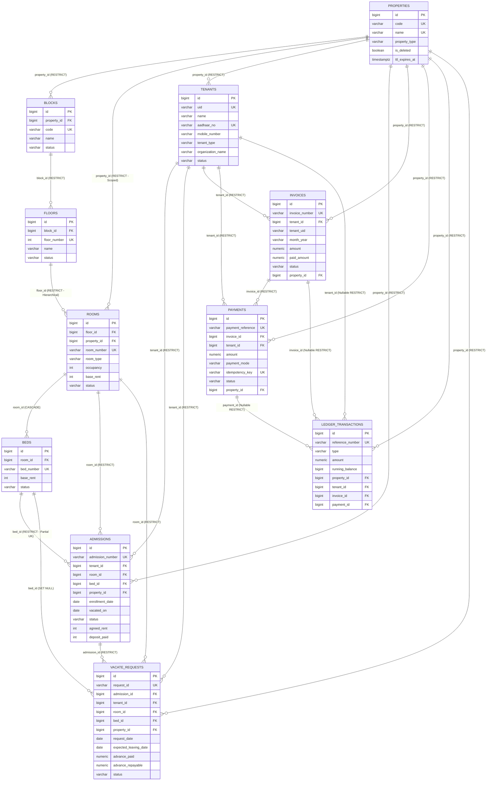

# Target Architecture Proposal (Phased Database Redesign)

**Project:** Residential Tenant Management and Rent Ledger (RMS)  
**Architecture Status:** Approved Target Design Baseline  
**Database Engine:** PostgreSQL 17+  
**ORM Framework:** Hibernate 6.x / Spring Data JPA 3.x  

---

## 1. Architectural Principles

1. **Surrogate Primary Keys:** All tables utilize clean `BIGINT GENERATED ALWAYS AS IDENTITY` primary keys. Natural business identifiers (`code`, `admission_number`, `invoice_number`, `payment_reference`, `request_id`, `aadhaar_no`, `uid`) are retained as unique-indexed attributes for API and integration stability.
2. **True Structural Hierarchy:**
   $$\text{Property} \longrightarrow \text{Block} \longrightarrow \text{Floor} \longrightarrow \text{Room} \longrightarrow \text{Bed}$$
3. **Property Multi-Tenancy Scoping:** Rooms are scoped to floors and properties. Uniqueness is scoped (`UNIQUE (property_id, room_number)`), permitting different properties to each operate a "Room 101".
4. **Separation of Resident Identity vs Stay History:**
   - `tenants` stores permanent citizen profile, KYC documents, and emergency contacts.
   - `admissions` stores the specific stay lifecycle, bed allocation, agreed rent, and stay interval.
   - A resident can re-enroll for subsequent stays over time without mutating their permanent identity profile.
5. **Decoupled Atomic Bed Inventory:**
   - The `beds` entity is the atomic unit of occupancy.
   - Transient counter columns on `rooms` (`current_occupancy`, `reserved_capacity`) are deprecated from the authoritative database model and derived dynamically from physical bed states.
6. **Double-Entry Financial Integrity & Immutability:**
   - Invoices, payments, refunds, and ledger transactions enforce complete referential integrity with `ON DELETE RESTRICT`.
   - Historical ledger records, transaction amounts, and running balances are strictly immutable.
   - Monetary values are represented using exact `NUMERIC(12, 2)` decimal precision, eliminating floating-point rounding errors.

---

## 2. Target Entity-Relationship Diagram



---

## 3. Authoritative Target DDL Specifications

### A. Property Management (`properties`)
```sql
CREATE TABLE properties (
    id BIGINT GENERATED ALWAYS AS IDENTITY PRIMARY KEY,
    code VARCHAR(50) NOT NULL UNIQUE,
    name VARCHAR(255) NOT NULL UNIQUE,
    property_logo VARCHAR(500),
    property_type VARCHAR(50) DEFAULT 'PG',
    address TEXT,
    city VARCHAR(100),
    state VARCHAR(100),
    pincode VARCHAR(20),
    contact_number VARCHAR(50),
    contact_email VARCHAR(255),
    total_floors INT DEFAULT 0,
    total_rooms INT DEFAULT 0,
    status VARCHAR(50) NOT NULL DEFAULT 'ACTIVE',
    is_deleted BOOLEAN NOT NULL DEFAULT FALSE,
    deleted_at TIMESTAMPTZ,
    deleted_by VARCHAR(255),
    deletion_reason TEXT,
    ttl_expires_at TIMESTAMPTZ,
    archive_snapshot_id BIGINT,
    created_at TIMESTAMPTZ NOT NULL DEFAULT NOW(),
    updated_at TIMESTAMPTZ NOT NULL DEFAULT NOW()
);
```

### B. Block Management (`blocks`)
```sql
CREATE TABLE blocks (
    id BIGINT GENERATED ALWAYS AS IDENTITY PRIMARY KEY,
    property_id BIGINT NOT NULL,
    name VARCHAR(100) NOT NULL,
    code VARCHAR(50) NOT NULL,
    status VARCHAR(50) NOT NULL DEFAULT 'ACTIVE',
    created_at TIMESTAMPTZ NOT NULL DEFAULT NOW(),
    updated_at TIMESTAMPTZ NOT NULL DEFAULT NOW(),
    CONSTRAINT fk_blocks_property FOREIGN KEY (property_id) REFERENCES properties(id) ON DELETE RESTRICT,
    CONSTRAINT uk_blocks_property_code UNIQUE (property_id, code)
);
```

### C. Floor Management (`floors`)
```sql
CREATE TABLE floors (
    id BIGINT GENERATED ALWAYS AS IDENTITY PRIMARY KEY,
    block_id BIGINT NOT NULL,
    floor_number INT NOT NULL,
    name VARCHAR(100) NOT NULL,
    status VARCHAR(50) NOT NULL DEFAULT 'ACTIVE',
    created_at TIMESTAMPTZ NOT NULL DEFAULT NOW(),
    updated_at TIMESTAMPTZ NOT NULL DEFAULT NOW(),
    CONSTRAINT fk_floors_block FOREIGN KEY (block_id) REFERENCES blocks(id) ON DELETE RESTRICT,
    CONSTRAINT uk_floors_block_number UNIQUE (block_id, floor_number)
);
```

### D. Room Management (`rooms`)
```sql
CREATE TABLE rooms (
    id BIGINT GENERATED ALWAYS AS IDENTITY PRIMARY KEY,
    floor_id BIGINT NOT NULL,
    property_id BIGINT NOT NULL,
    room_number VARCHAR(50) NOT NULL,
    room_type VARCHAR(50) NOT NULL DEFAULT 'SHARED',
    occupancy INT NOT NULL DEFAULT 1,
    base_rent INT NOT NULL,
    status VARCHAR(50) NOT NULL DEFAULT 'ACTIVE', -- ACTIVE, UNDER_MAINTENANCE, INACTIVE
    created_at TIMESTAMPTZ NOT NULL DEFAULT NOW(),
    updated_at TIMESTAMPTZ NOT NULL DEFAULT NOW(),
    CONSTRAINT fk_rooms_floor FOREIGN KEY (floor_id) REFERENCES floors(id) ON DELETE RESTRICT,
    CONSTRAINT fk_rooms_property FOREIGN KEY (property_id) REFERENCES properties(id) ON DELETE RESTRICT,
    CONSTRAINT uk_rooms_property_number UNIQUE (property_id, room_number)
);
```

### E. Bed Inventory (`beds`)
```sql
CREATE TABLE beds (
    id BIGINT GENERATED ALWAYS AS IDENTITY PRIMARY KEY,
    room_id BIGINT NOT NULL,
    bed_number VARCHAR(50) NOT NULL,
    base_rent INT,
    status VARCHAR(50) NOT NULL DEFAULT 'AVAILABLE', -- AVAILABLE, OCCUPIED, RESERVED, MAINTENANCE
    created_at TIMESTAMPTZ NOT NULL DEFAULT NOW(),
    updated_at TIMESTAMPTZ NOT NULL DEFAULT NOW(),
    CONSTRAINT fk_beds_room FOREIGN KEY (room_id) REFERENCES rooms(id) ON DELETE CASCADE,
    CONSTRAINT uk_beds_room_number UNIQUE (room_id, bed_number)
);
```

### F. Tenant Identity Profiles (`tenants`)
```sql
CREATE TABLE tenants (
    id BIGINT GENERATED ALWAYS AS IDENTITY PRIMARY KEY,
    uid VARCHAR(100) NOT NULL UNIQUE, -- Stable external integration UUID
    name VARCHAR(255) NOT NULL,
    aadhaar_no VARCHAR(100) NOT NULL UNIQUE,
    mobile_number VARCHAR(50) NOT NULL,
    tenant_type VARCHAR(50) NOT NULL DEFAULT 'WORKING',
    organization_name VARCHAR(255),
    parent_contact VARCHAR(50),
    status VARCHAR(50) NOT NULL DEFAULT 'ACTIVE',
    property_id BIGINT REFERENCES properties(id) ON DELETE RESTRICT,
    created_at TIMESTAMPTZ NOT NULL DEFAULT NOW(),
    updated_at TIMESTAMPTZ NOT NULL DEFAULT NOW()
);
```

### G. Admissions Lifecycle (`admissions`)
```sql
CREATE TABLE admissions (
    id BIGINT GENERATED ALWAYS AS IDENTITY PRIMARY KEY,
    admission_number VARCHAR(50) NOT NULL UNIQUE,
    tenant_id BIGINT NOT NULL,
    room_id BIGINT NOT NULL,
    bed_id BIGINT,
    property_id BIGINT NOT NULL,
    enrollment_date DATE NOT NULL,
    vacated_on DATE,
    status VARCHAR(50) NOT NULL DEFAULT 'PENDING', -- PENDING, PAID, CANCELLED, VACATED
    agreed_rent INT,
    deposit_paid INT,
    remarks TEXT,
    confirmed_on TIMESTAMPTZ,
    created_at TIMESTAMPTZ NOT NULL DEFAULT NOW(),
    updated_at TIMESTAMPTZ NOT NULL DEFAULT NOW(),
    CONSTRAINT fk_admissions_tenant FOREIGN KEY (tenant_id) REFERENCES tenants(id) ON DELETE RESTRICT,
    CONSTRAINT fk_admissions_room FOREIGN KEY (room_id) REFERENCES rooms(id) ON DELETE RESTRICT,
    CONSTRAINT fk_admissions_bed FOREIGN KEY (bed_id) REFERENCES beds(id) ON DELETE RESTRICT,
    CONSTRAINT fk_admissions_property FOREIGN KEY (property_id) REFERENCES properties(id) ON DELETE RESTRICT
);

-- CRITICAL OCCUPANCY PARTIAL UNIQUE INDEX (DEC-003):
-- Guarantees at most one active or reserved occupant per bed, while permitting unlimited historical stays.
CREATE UNIQUE INDEX uk_admissions_active_bed_exclusive
ON admissions (bed_id)
WHERE status IN ('PENDING', 'PAID') AND bed_id IS NOT NULL;
```

### H. Vacate Requests & Checkout Settlement (`vacate_requests`)
```sql
CREATE TABLE vacate_requests (
    id BIGINT GENERATED ALWAYS AS IDENTITY PRIMARY KEY,
    request_id VARCHAR(50) NOT NULL UNIQUE,
    admission_id BIGINT NOT NULL,
    tenant_id BIGINT NOT NULL,
    room_id BIGINT NOT NULL,
    bed_id BIGINT,
    property_id BIGINT NOT NULL,
    request_date DATE NOT NULL,
    expected_leaving_date DATE NOT NULL,
    actual_vacate_date DATE,
    notice_days INT NOT NULL,
    advance_paid NUMERIC(12, 2) NOT NULL DEFAULT 0.00,
    maintenance_charge NUMERIC(12, 2) DEFAULT 0.00,
    breakage_charge NUMERIC(12, 2) DEFAULT 0.00,
    advance_repayable NUMERIC(12, 2) NOT NULL DEFAULT 0.00,
    status VARCHAR(50) NOT NULL DEFAULT 'PENDING', -- PENDING, APPROVED, REJECTED, COMPLETED, CANCELLED
    reason TEXT,
    notes TEXT,
    created_at TIMESTAMPTZ NOT NULL DEFAULT NOW(),
    updated_at TIMESTAMPTZ NOT NULL DEFAULT NOW(),
    CONSTRAINT fk_vacate_admission FOREIGN KEY (admission_id) REFERENCES admissions(id) ON DELETE RESTRICT,
    CONSTRAINT fk_vacate_tenant FOREIGN KEY (tenant_id) REFERENCES tenants(id) ON DELETE RESTRICT,
    CONSTRAINT fk_vacate_room FOREIGN KEY (room_id) REFERENCES rooms(id) ON DELETE RESTRICT,
    CONSTRAINT fk_vacate_bed FOREIGN KEY (bed_id) REFERENCES beds(id) ON DELETE SET NULL,
    CONSTRAINT fk_vacate_property FOREIGN KEY (property_id) REFERENCES properties(id) ON DELETE RESTRICT
);
```

### I. Invoices (`invoices`)
```sql
CREATE TABLE invoices (
    id BIGINT GENERATED ALWAYS AS IDENTITY PRIMARY KEY,
    invoice_number VARCHAR(50) NOT NULL UNIQUE,
    tenant_id BIGINT NOT NULL REFERENCES tenants(id) ON DELETE RESTRICT,
    tenant_uid VARCHAR(100) NOT NULL,
    month_year VARCHAR(50) NOT NULL,
    amount NUMERIC(12, 2) NOT NULL,
    paid_amount NUMERIC(12, 2) NOT NULL DEFAULT 0.00,
    due_date VARCHAR(50) NOT NULL,
    status VARCHAR(50) NOT NULL DEFAULT 'PENDING', -- PENDING, PARTIALLY_PAID, PAID, OVERDUE
    paid_on VARCHAR(50),
    payment_mode VARCHAR(50),
    transaction_ref VARCHAR(100),
    property_id BIGINT NOT NULL REFERENCES properties(id) ON DELETE RESTRICT,
    created_at TIMESTAMPTZ NOT NULL DEFAULT NOW(),
    CONSTRAINT uk_invoices_tenant_month UNIQUE (tenant_uid, month_year)
);
```

### J. Authoritative Payments (`payments`)
```sql
CREATE TABLE payments (
    id BIGINT GENERATED ALWAYS AS IDENTITY PRIMARY KEY,
    payment_reference VARCHAR(50) NOT NULL UNIQUE,
    invoice_id BIGINT NOT NULL REFERENCES invoices(id) ON DELETE RESTRICT,
    tenant_id BIGINT NOT NULL REFERENCES tenants(id) ON DELETE RESTRICT,
    amount NUMERIC(12, 2) NOT NULL,
    payment_mode VARCHAR(50) NOT NULL,
    transaction_reference VARCHAR(100),
    idempotency_key VARCHAR(255) NOT NULL UNIQUE,
    status VARCHAR(50) NOT NULL DEFAULT 'SUCCESS', -- SUCCESS, FAILED
    property_id BIGINT NOT NULL REFERENCES properties(id) ON DELETE RESTRICT,
    created_at TIMESTAMPTZ NOT NULL DEFAULT NOW()
);
```

### K. Double-Entry General Ledger (`ledger_transactions`)
```sql
CREATE TABLE ledger_transactions (
    id BIGINT GENERATED ALWAYS AS IDENTITY PRIMARY KEY,
    reference_number VARCHAR(100) NOT NULL UNIQUE,
    date VARCHAR(50) NOT NULL,
    type VARCHAR(50) NOT NULL, -- CREDIT, DEBIT
    account_head VARCHAR(100) NOT NULL,
    description TEXT NOT NULL,
    tenant_or_vendor VARCHAR(255) NOT NULL,
    amount NUMERIC(12, 2) NOT NULL,
    payment_mode VARCHAR(50) NOT NULL,
    running_balance BIGINT NOT NULL,
    property_id BIGINT NOT NULL REFERENCES properties(id) ON DELETE RESTRICT,
    tenant_id BIGINT REFERENCES tenants(id) ON DELETE RESTRICT, -- Nullable for legacy rows
    invoice_id BIGINT REFERENCES invoices(id) ON DELETE RESTRICT, -- Nullable for legacy rows
    payment_id BIGINT REFERENCES payments(id) ON DELETE RESTRICT, -- Nullable for legacy rows
    tenant_uid VARCHAR(100),
    created_at TIMESTAMPTZ NOT NULL DEFAULT NOW()
);
```

---

## 4. Operational Boundaries & Concurrency Model

1. **Bed Allocation Pessimistic Locking:**
   When enrolling or confirming an admission, the backend executes:
   ```sql
   SELECT * FROM beds WHERE id = :bedId FOR UPDATE;
   ```
   This prevents concurrent requests from attempting to allocate the same bed slot.
2. **Double-Booking Engine-Level Protection:**
   The partial unique index `uk_admissions_active_bed_exclusive` provides absolute, hardware-level serialization against race conditions. Any concurrent transaction attempting to insert a second active admission on the same bed is rejected by PostgreSQL with a unique constraint violation error.
3. **Atomic Vacate & Settlement:**
   The `completeVacate()` service method executes within an atomic `@Transactional` boundary, updating the vacate request, marking the admission `VACATED`, releasing the bed to `AVAILABLE`, and appending deposit refund records to `ledger_transactions`.
